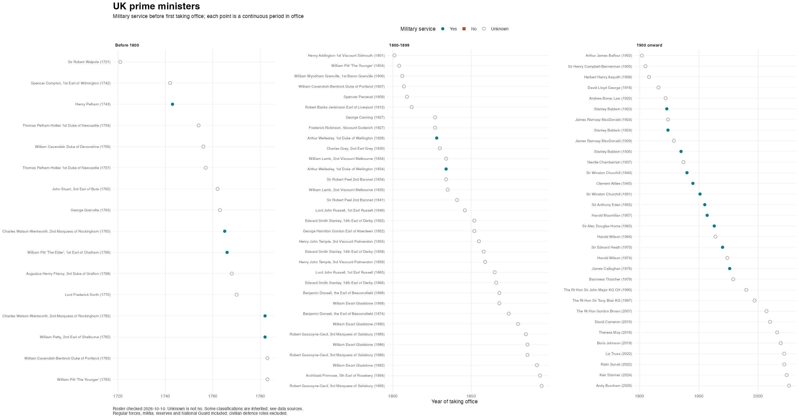
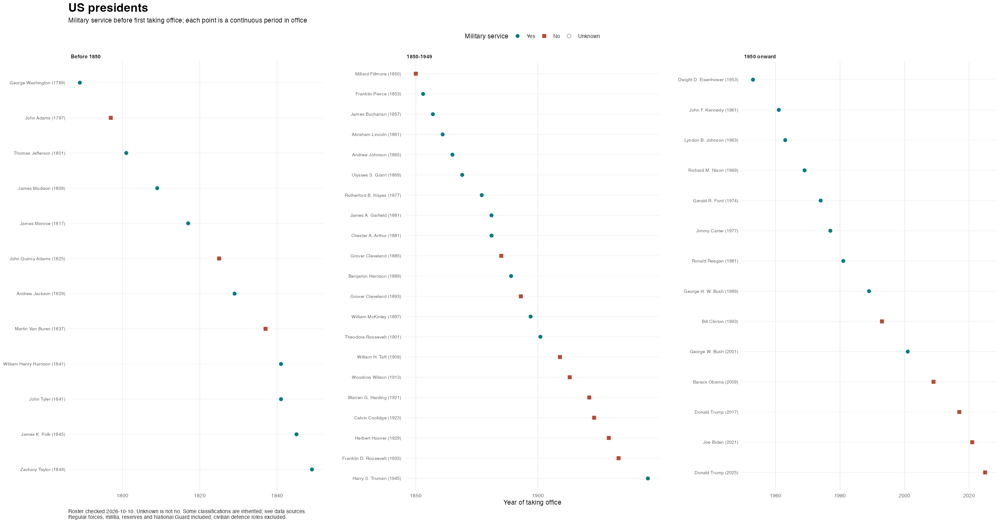

# Military experience of US presidents and UK prime ministers

Historical leadership rosters, military-service classifications, and reproducible R charts.
The rosters were checked through **2026-10-10** against the
[US House of Representatives](https://history.house.gov/Institution/Presidents-Coinciding/Presidents-Coinciding/)
and [GOV.UK](https://www.gov.uk/government/ministers/prime-minister).


|Country        | Periods in office| People| Service: yes| Service: no| Unknown|
|:--------------|-----------------:|------:|------------:|-----------:|-------:|
|United States  |                47|     45|           30|          15|       0|
|United Kingdom |                81|     59|           13|           0|      46|

Service counts refer to **distinct people**, not elections or periods in office.
Returning leaders keep the same `leader_id`; their separate periods have different
`term_id` values. The US roster ends with Donald Trump;
the UK roster ends with Andy Burnham.

## Data and definitions

- [US presidents](data/us_presidents.csv)
- [UK prime ministers](data/uk_prime_ministers.csv)
- [Data dictionary and updating instructions](docs/data_dictionary.md)
- [Unmodified original CSVs](data-raw/)

All maintained column names use lower snake case. Each row is one continuous
period in office, combining consecutive re-elections. Tenure years are calendar
years, not durations. A blank `end_year` identifies the incumbent at the snapshot
date; it does not predict a departure date.

`military_experience` is `1` for military service before first taking office,
`0` for a negative classification, and blank for unknown. The definition includes
regular forces, militia, reserves, the Territorial Army and the National Guard.
It excludes civilian defence administration, school cadet training, and military
service that began only after leaving office. It is not a legal definition of
veteran status and does not imply combat experience.

`military_evidence` distinguishes sourced classifications from inherited ones.
**Roster currency does not mean every service classification has been verified.**
In particular, the UK source left most service fields blank; these remain unknown
unless affirmative evidence was found. New UK biographies establish officeholding
but do not by themselves establish the absence of military service.

## Charts





Charts show every period in office, including unknown service status. They use
local data and have no network dependency or hand-adjusted label positions.

## Reproduce

Use R >= 4.1 with `make` from the repository root:

```sh
make install
make check
```

The only direct package dependencies are `ggplot2` for charts and `knitr` for
this generated README. CSV reading and data checks use base R.
`make check` tests the data and plotting logic, then rebuilds both charts and
this README. `make build` and `make test` can also be run separately.
Edit `README.Rmd`, then run `make build` to update `README.md`.

To use the data in R:

```r
source("R/military_experience.R")
us_presidents <- read_leaders("data/us_presidents.csv")
validate_leaders(us_presidents, read_snapshot())
```

## License

[Creative Commons Attribution-ShareAlike 4.0](License.md), by Gaurav Sood.
Source URLs are recorded in each dataset. The historical input files are retained
for provenance and contain unverified notes; use the maintained tables for analysis.
